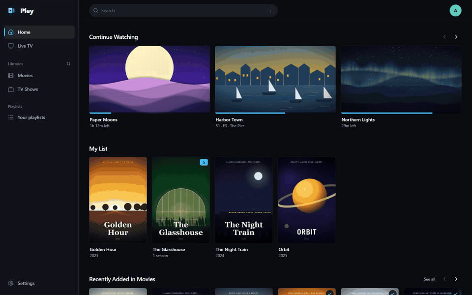
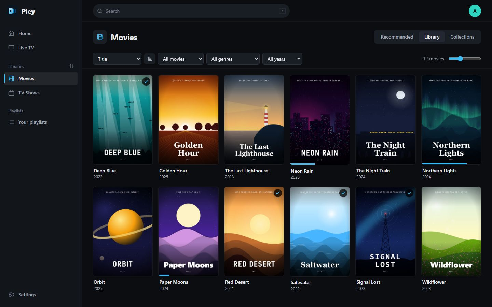
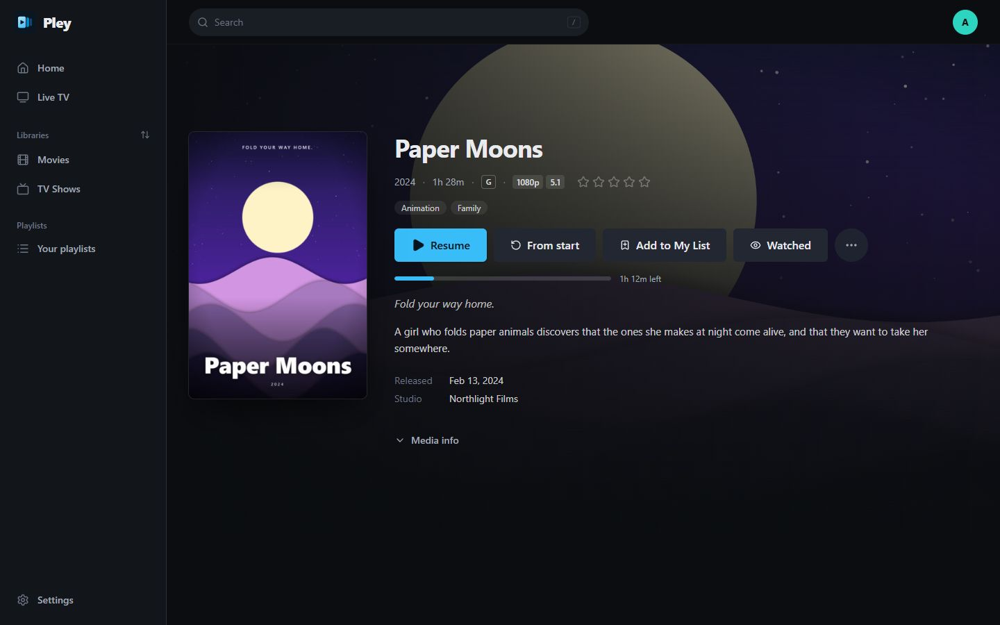
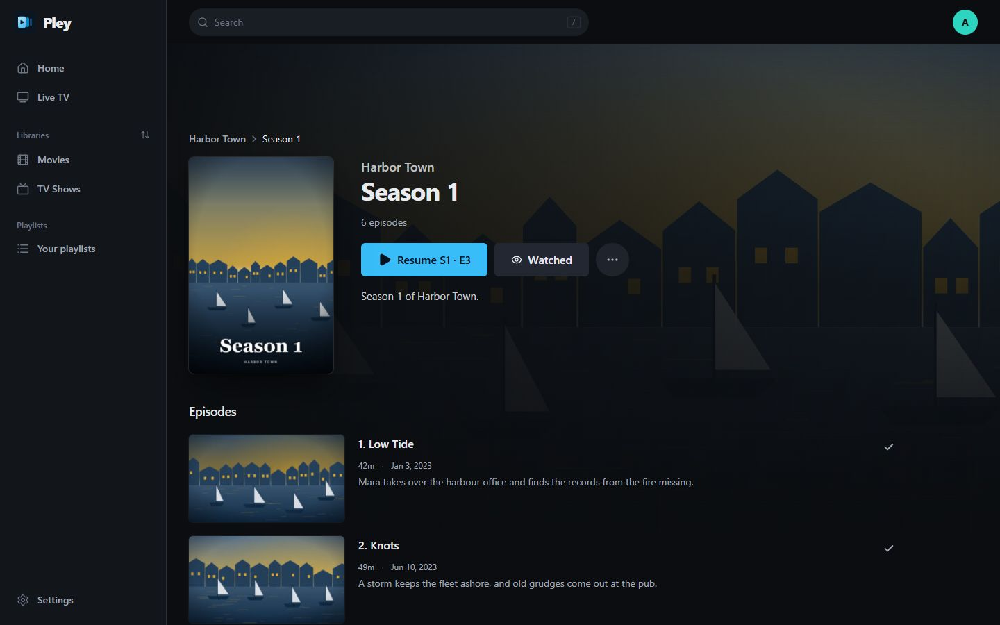
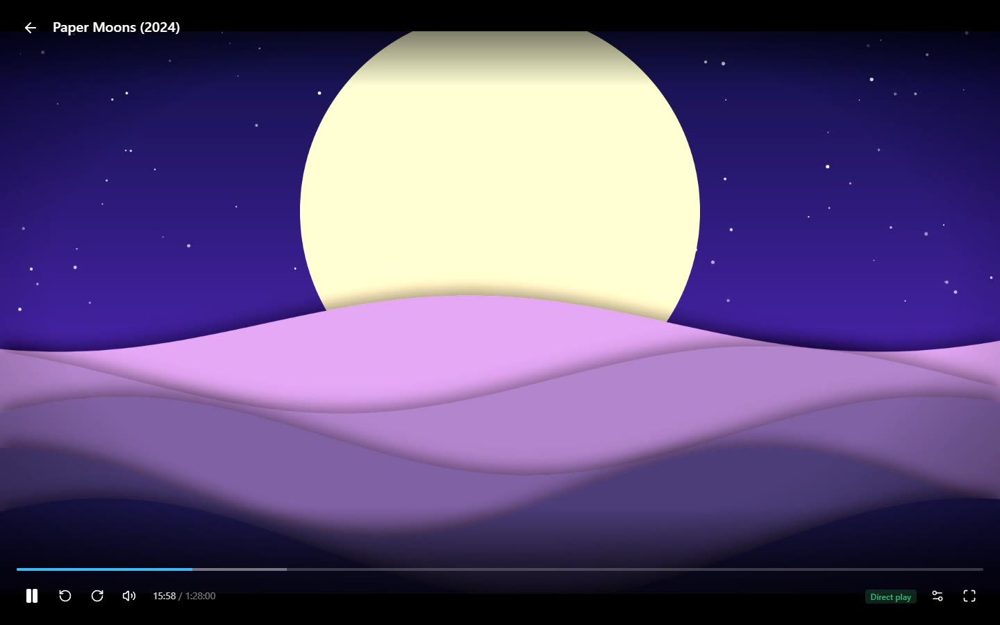

<h1 align="center">Pley</h1>

A self-hosted media server for movies, shows, music and live TV.

<table>
  <tr>
    <td width="50%"></td>
    <td width="50%"></td>
  </tr>
  <tr>
    <td width="50%"></td>
    <td width="50%"></td>
  </tr>
  <tr>
    <td width="50%"></td>
    <td width="50%"></td>
  </tr>
</table>

## Features

- Plays files as they are, or transcodes on the GPU
- HDR10, HLG and Dolby Vision tone mapping
- Live TV from M3U and Xtream Codes, with XMLTV guides
- Profiles, PINs and two-step sign-in
- Works offline on the home network

[All features](docs/FEATURES.md)

## Apps

Web, Windows, macOS, Linux, [Android](docs/ANDROID.md), [Kodi](docs/KODI.md),
[Roku](docs/ROKU.md), [Samsung TV and LG TV](docs/TV_PLATFORMS.md).

## Install

- [Docker](deploy/docker/README.md)
- [Unraid](deploy/unraid/README.md)
- [Windows](deploy/windows/README.md)
- [Linux and macOS](deploy/README.md)

Then [first start](docs/CONFIGURATION.md#first-start).

## Architecture

## Docs

[Features](docs/FEATURES.md) ·
[Configuration](docs/CONFIGURATION.md) ·
[Quality](docs/QUALITY.md) ·
[Storage](docs/STORAGE.md) ·
[API](docs/API.md) ·
[Compatibility API](docs/COMPATIBILITY.md) ·
[Transcoder](docs/TRANSCODER.md) ·
[Development](docs/DEVELOPMENT.md) ·
[Releasing](docs/RELEASING.md) ·
[Security](SECURITY.md)

## License

Restricted, terms to be determined ([LICENSE](LICENSE)). The Kodi add-on is
GPL-2.0-or-later. Third-party notices: [LICENSING.md](LICENSING.md).
