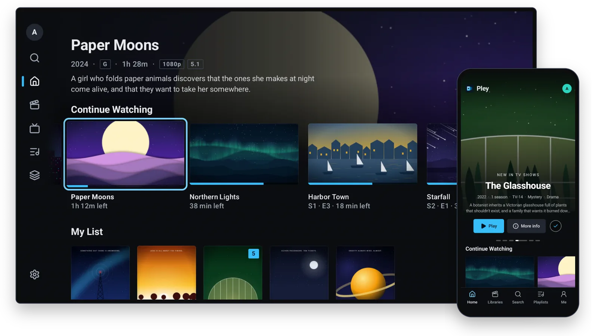
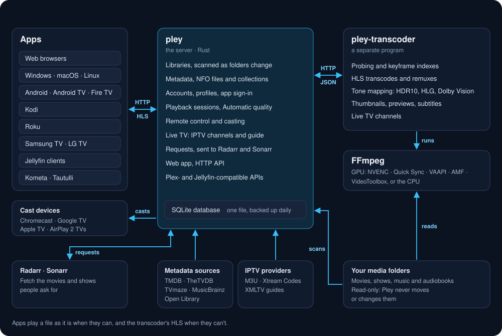

<h1 align="center">Pley</h1>

A self-hosted media server for movies, shows, music, audiobooks and live TV.

 
<!-- latest releases: written by scripts/release.mjs when an app is released -->

<!-- /latest releases -->

> [!WARNING]
> Pley is still in testing: expect rough edges, and keep backups of your data.

## Features

- Support for Movies, TV Shows, Music and Audiobooks
- IPTV from M3U playlists and Xtream Codes, with XMLTV guides
- HW accelerated transcoding with dynamic quality adjustment
- HDR10, HLG and Dolby Vision, tone mapping for SDR screens
- Skip Intro and Skip Credits
- Customizable Collections (TMDB, hand-picked or smart)
- Control playback on your other devices, or cast to Chromecast and AirPlay
- [Home Assistant integration](https://github.com/pley-media-server/pley-homeassistant)
  to see and control what's playing
- Works offline on your home network, with downloads for when you're away
- Profiles, PINs, two-step sign-in and age-based parental controls
- Requests for movies and shows, sent to Radarr and Sonarr
- Import from Plex: libraries, users and watch history
- Plex and Jellyfin compatible APIs for tools like Kometa

[All features](docs/FEATURES.md)

## Apps

Web, Windows, macOS, Linux, [Android](docs/ANDROID.md) (phones, tablets,
Android TV, Google TV and Fire TV), [Kodi](docs/KODI.md),
[Roku](docs/ROKU.md), [Samsung TV](docs/TV_PLATFORMS.md),
[LG TV](docs/LG.md). Apps for iPhone, iPad, Mac and Apple TV are
[in development](docs/APPLE.md). Jellyfin clients, Kometa and Tautulli
also work, through the [compatibility APIs](docs/COMPATIBILITY.md).

## Install

- [Docker](deploy/docker/README.md)
- [Unraid](deploy/unraid/README.md)
- [Synology](deploy/synology/README.md)
- [Windows](deploy/windows/README.md)
- [Linux and macOS](deploy/README.md)

Then [first start](docs/CONFIGURATION.md#first-start), and
[moving from Plex](docs/MOVING_FROM_PLEX.md) if you're coming from it.

## Architecture

## Docs

[Features](docs/FEATURES.md) ·
[Configuration](docs/CONFIGURATION.md) ·
[Moving from Plex](docs/MOVING_FROM_PLEX.md) ·
[Quality](docs/QUALITY.md) ·
[Storage](docs/STORAGE.md) ·
[API](docs/API.md) ·
[Compatibility APIs](docs/COMPATIBILITY.md) ·
[Transcoder](docs/TRANSCODER.md) ·
[Development](docs/DEVELOPMENT.md) ·
[Releasing](docs/RELEASING.md) ·
[Security](SECURITY.md)

## License

Pley is free software under the GNU Affero General Public License, version
3 ([LICENSE](LICENSE)). The Kodi add-on is GPL-2.0-or-later. What that
means, and third-party notices: [LICENSING.md](LICENSING.md). How to
contribute, and the license of a contribution:
[CONTRIBUTING.md](CONTRIBUTING.md).
