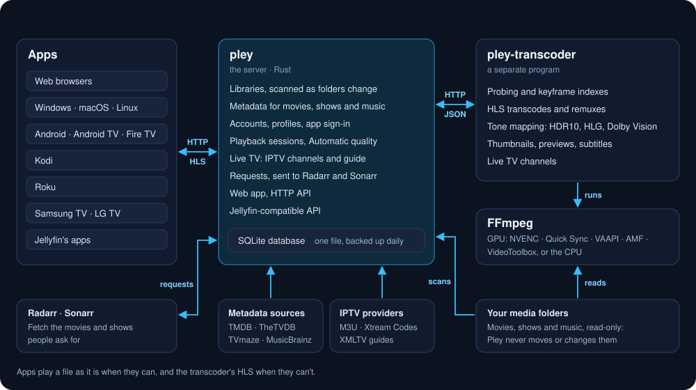

# Development

How Pley is built, tested and released.

## Architecture

<p align="center">
  
</p>

The transcoder is a separate program, the only one that runs FFmpeg, and the
server talks to it only over HTTP ([TRANSCODER.md](TRANSCODER.md)).

| Path | What |
|---|---|
| `apps/server` | The media server (crate `pley-server`, binary `pley`) |
| `apps/transcoder` | The FFmpeg engine (crate and binary `pley-transcoder`) |
| `apps/web` | The web app (React, TypeScript, Vite, Tailwind), embedded into the server |
| `apps/desktop` | Pley for Windows, macOS and Linux (Tauri) |
| `apps/android` | Pley for Android phones, tablets and TVs (Kotlin, Compose, Media3) |
| `apps/apple` | Pley for iPhone, iPad, Mac and Apple TV (Swift, SwiftUI), in development |
| `apps/kodi` | Pley for Kodi, an add-on (Python, GPL-2.0-or-later) |
| `apps/roku` | Pley for Roku (BrightScript, SceneGraph) |
| `apps/tizen` | Pley for Samsung TV, a web app for Tizen |
| `apps/tizen-native` | Pley for Samsung TV, native (C#, Tizen .NET, NUI), built beside the web app |
| `apps/webos` | Pley for LG TV, a native webOS app (Rust, a Cargo workspace of its own) |
| `packages/tv` | The Samsung TV app's screens, player and API client (TypeScript, Preact) |
| `packages/transcoder-api` | Protocol types shared by server and transcoder |
| `deploy/` | Docker, systemd and launchd setups, the Windows installer, store listings |
| `docs/` | Documentation |
| `scripts/` | Versions and releases (`version.mjs`, `release.mjs`), release builds, the license checks, the apps' icons and store pictures (`render-icons.mjs`), marking a pull request's screenshots and animations (`mark-screenshot.mjs`, `mark-animation.mjs`), recording the Android app's animations (`record-android.mjs`) |

## Requirements

- Rust 1.95 or newer.
- [Bun](https://bun.sh) 1.4 or newer (`package.json` pins 1.4.4) to build the
  web app and the other JavaScript apps. Bun installs packages from
  `bun.lock` and runs their scripts and tools (each package's `bunfig.toml`
  says so).
- Node.js 22 or newer, for the Roku app's tools only.
- The .NET 8 SDK, for the native Samsung app only.
- For the LG app's TV build, Linux with the webOS toolchain, or Docker
  ([LG.md](LG.md#the-tv-build)); its tests and simulator need only Rust.
- FFmpeg and ffprobe on `PATH` or configured; 6.1 or newer throttles
  transcodes. For hardware transcoding and GPU tone mapping, use a build
  with NVENC, QSV, AMF or VAAPI and libplacebo: gyan.dev's "full" build on
  Windows, Debian 13's or jellyfin-ffmpeg on Linux, Homebrew's `ffmpeg-full`
  on macOS ([deploy/README.md](../deploy/README.md)).

## Running from source

```powershell
bun install; bun run build                       # build the web app (embedded into the server)
cargo build                                      # build pley and pley-transcoder
.\target\debug\pley.exe --data-dir .\data        # http://localhost:7539
```

Then follow [First start](CONFIGURATION.md#first-start).

## Building and testing

| Command | What |
|---|---|
| `bun run dev` | The web app with hot reload on `http://localhost:5173`, proxying `/api` to the server on port 7539. Debug builds of the server read `apps/web/dist` from disk, so `bun run build` shows up without recompiling |
| `bun install --frozen-lockfile` | Installs exactly what `bun.lock` holds, as CI and the Docker build do |
| `cargo test --workspace` | The Rust tests, including end-to-end tests of both APIs |
| `cargo test -p pley-server --test providers -- --ignored` | Also checks the real TVmaze and MusicBrainz (and TheTVDB with `PLEY_TEST_TVDB_KEY` and, if needed, `PLEY_TEST_TVDB_PIN`) |
| `cargo clippy --workspace --all-targets`, `cargo fmt --all` | Lint and format the Rust code |
| `scripts/check-licenses.ps1` | Checks that no copyleft-only crate is in the server, the transcoder or the LG app ([LICENSING.md](../LICENSING.md)) |
| `bun run check` | The web app's and desktop app's type check, ESLint and tests (Vitest) |
| `bun run desktop` | Runs the desktop app (on Linux needs WebKitGTK: `libwebkit2gtk-4.1-dev`); `bun run --cwd apps/desktop build` makes its installers |
| `bun run tv:check` | Type-checks and tests the Samsung app; `bun run tizen` packages it ([TV_PLATFORMS.md](TV_PLATFORMS.md)) |
| `dotnet test apps/tizen-native/test/Pley.Tv.Core.Tests` | Tests the native Samsung app's logic; `bun run tizen-native` packages it ([TV_PLATFORMS.md](TV_PLATFORMS.md#the-native-samsung-app)) |
| `cargo test --workspace` in `apps/webos` | Tests the LG app; `cargo clippy --workspace --all-targets` and `cargo fmt --all` there lint and format it, `cargo run -- --fixtures` starts its simulator, and `cargo xtask` builds and packs it for the TV ([LG.md](LG.md#building-and-testing)) |
| `bun install && bun run check` in `apps/roku` | Compiles, lints and tests the Roku app ([ROKU.md](ROKU.md)) |
| `python -m unittest discover -s tests` in `apps/kodi` | Tests the Kodi add-on ([KODI.md](KODI.md)) |
| `swift test --package-path apps/apple/PleyKit` | Tests the Apple apps' packages on a Mac; [APPLE.md](APPLE.md#building-and-testing) has the simulator tests and the apps' `xcodebuild` builds |
| `scripts/build.ps1` (or `build.sh`) | Builds the server's release archive locally |
| `scripts/build-spk.sh` | Builds the Synology package from the static Linux archive ([deploy/synology](../deploy/synology/README.md)) |

Rust tests that open a database, start a server or run FFmpeg make their
temporary folders with `testing::tempdir()` (`common::tempdir()` in the
server's integration tests), not `tempfile::tempdir()`. On Windows those
files are still open when a test's `TempDir` is dropped, so its folder would
stay behind in the temporary folder; these are removed once the test's
thread ends.

The Android app builds with the Android SDK and JDK 17 or newer (on Windows,
Android Studio's: `JAVA_HOME=C:\Program Files\Android\Android Studio\jbr`).
In `apps/android`:

```sh
./gradlew testDebugUnitTest lintDebug assembleDebug assembleStoreRelease   # as CI does
pwsh ../../scripts/check-android.ps1                                      # the release's libraries, native code and size
adb install app/build/outputs/apk/store/debug/app-store-debug.apk         # the debug app
```

Builds come in two flavors, `store` and `direct`; [ANDROID.md](ANDROID.md)
has the modules and the rest.

[GitHub Actions](../.github/workflows) runs these checks on every push and
pull request, each app's workflow only when that app (or what it is built
from) changes. The server's runs on Linux, macOS and Windows, with a build on
the oldest supported Rust, the license check and the Docker build
([RELEASING.md](RELEASING.md#ci)).

The README's screenshot (`docs/images/web-home.jpg`) shows a demo library of
made-up titles ([scripts/store-library](../scripts/store-library/README.md)):
`bun scripts/store-library/web.mjs <dir> <address>` takes it from a server
holding it.

## Versions and releases

Each app (the server with its transcoder and web app, desktop, Android,
Samsung, LG, Kodi and Roku) has its own version and `CHANGELOG.md`. A release
takes the apps whose versions went up, under one tag (`release-2026-11-02`):
the Prepare release workflow bumps them in a pull request, and merging it
builds and publishes them. Every app shows the commit it was built from
beside its version, as "0.0.1 (1a2b3c4d5)". [RELEASING.md](RELEASING.md) has
the details.

## Screenshots for a pull request

A pull request that changes what people see shows it: the same screen
before and after, through the same steps, before on the base branch and
after on the pull request's. Each app is captured its own way:

| App | Screenshot |
|---|---|
| Web and desktop | The browser's or the system's own |
| Android, phone and TV | `adb exec-out screencap -p > shot.png` |
| Native Samsung app | Its debug build takes them from the computer: `metrics.mjs shot` ([TV_PLATFORMS.md](TV_PLATFORMS.md), "Profiling"); a video's picture comes out black |
| Kodi | Kodi's own (the `screenshot` action); [KODI.md](KODI.md) has the setting that keeps the whole screen drawn |
| Roku | The developer page's Utilities → Screenshot, of a sideloaded app; a video's picture doesn't come out |
| LG | The simulator writes the frame as PNG: `cargo run -- --fixtures --keys "<keys>" --screenshot shot.png` in `apps/webos`, with `--screenshot-after <ms>` for a playing video ([LG.md](LG.md#the-simulator)); the simulator's player draws no picture, so a video's place stays empty |
| Samsung web app | A photo of the screen |

`scripts/mark-screenshot.mjs` marks where to look, in the screenshot's own
pixels, and writes a PNG; it takes a phone's JPEG too:

```sh
bun scripts/mark-screenshot.mjs before.png before-marked.png --box 176,40,550,370 --arrow 1000,560,740,410
bun scripts/mark-screenshot.mjs before.png corner.png --zoom 84,416,160,100 --box 88,454,20,60   # 5× there, pixel for pixel
```

A change that moves (an animation, a transition) is shown moving. The native
Samsung app's debug build records one frame by frame (`metrics.mjs record`,
[TV_PLATFORMS.md](TV_PLATFORMS.md), "Profiling"), and
`scripts/record-android.mjs` records the Android app, phone or TV, through
adb ([ANDROID.md](ANDROID.md#recording-an-animation));
`scripts/mark-animation.mjs` marks the frames as `mark-screenshot.mjs` marks
a screenshot and writes an animated PNG, slower than it was where the change
is too quick to see, which the caption says. GitHub takes pictures up to
10 MB: a smaller `--scale`, a longer `--step` or a quicker `--speed` makes one
smaller, which counts where the whole screen moves, as in a crossfade.

```sh
bun scripts/mark-animation.mjs apps/tizen-native/out/rec-<time>-<model> after.png --speed 0.2 --box 4,28,164,1024 --arrow 480,740,184,740
```

The pictures are attached to the pull request, never committed:
`gh pr create --attach ./after.png` (gh 2.102 or later) uploads each one and
points `` in the description at it.

## Contributing

- Run the checks for what you changed ([Building and testing](#building-and-testing));
  CI runs them too.
- Commit messages start with the area they touch, as in the history:
  `transcoder: …`, `kodi, roku: …`, `docs: …`.
- Add a line under `## [Unreleased]` in the changed app's `CHANGELOG.md`
  ([RELEASING.md](RELEASING.md#releasing)).
- Report security issues as [SECURITY.md](../SECURITY.md) describes, not in a
  public issue.
